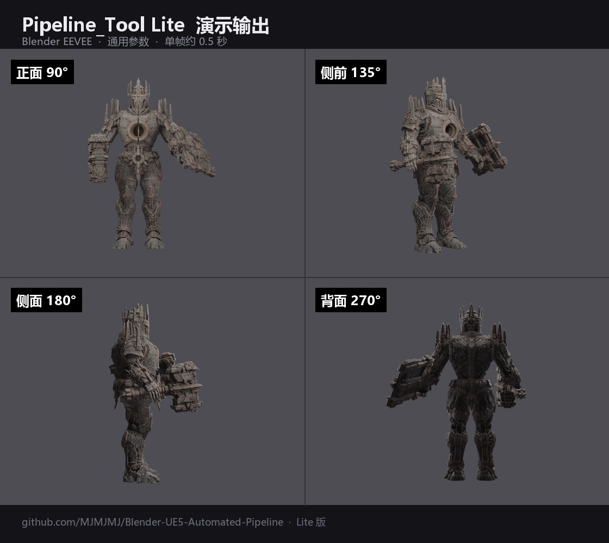

# Pipeline_Tool Lite

> ## 版权与商业声明
>
> **本项目采用「个人学习与商业限制许可」，不是 MIT，不是 GPL —— 是保留商业权利的自定义协议。**
>
> **允许**：个人下载源码、学习研究、技术交流、非商业性修改
>
> **严禁**（未经作者 **MJMJMJ** 书面授权）：
> - 拿本项目源码或衍生物去闲鱼/淘宝/任何平台倒卖、出租、代打包售卖
> - 用于商业接单（包括用本工具向客户提供付费渲染服务）
> - 企业部署（在公司内部署用于生产经营）
> - 改个名字/换个皮就宣称是自己的作品
>
> 完整条款见 [LICENSE](LICENSE)

---



---

3D 资产批处理与渲染的**开源演示版**。

把 `FBX 模型 → 减面生成 LOD → Blender EEVEE 渲染` 串成一条命令，
用于学习和研究 3D 管线自动化是怎么做的。

## 这个版本能做什么

| 功能 | 说明 |
| --- | --- |
| zip / fbx 输入 | 自动解压，含中文乱码修复（cp437 → gbk） |
| 文件名安全化 | 处理 Windows 非法字符和超长路径 |
| 基础减面 | Blender DECIMATE 修改器，生成 3 级 LOD |
| 基础渲染 | Blender EEVEE，单角度出图 |
| 简单归档 | 产物按任务分子目录 |

## 这个版本不含什么

> 以下是完整版才有的能力。Lite 版刻意移除了**针对性调优的参数**，
> 所以出图效果会明显不如完整版 —— 这是设计如此，不是 bug。

- 精细三灯配比（60/22/30 的强度与色温组合）
- 精确曝光控制（针对不同材质微调 EV）
- 锈色染色材质链路（灰度提取 + 颜色混合 + 粗糙度遮罩）
- 多套商业风格预设（暗金属 / 落日 / 赛博 / 废墟）
- 多角度环绕渲染与逐角度重排灯光
- 收件箱批量扫描
- 自动交付清单生成
- UE5 渲染后端

## 快速开始

### 1. 环境要求

- Python 3.8+
- Blender 3.0+（路径写进配置文件）

### 2. 配置

首次运行会自动生成 `lite_config.json`：

```bash
python Pipeline_Tool_Lite.py some_model.fbx
```

然后修改里面的 `blender_exe`：

```json
{
  "blender_exe": "D:/blender.exe"
}
```

### 3. 运行

```bash
# 处理单个模型
python Pipeline_Tool_Lite.py path/to/model.fbx

# 处理压缩包
python Pipeline_Tool_Lite.py path/to/package.zip
```

产物在 `work/<任务名>/output/`。

### 输出示例

上方的四角度图就是 Lite 版的实际输出
（StoneGolem 模型，1440×1080，通用默认参数）。

> **注意**：这是**通用参数**下的效果。完整版经过针对性调优，
> 出图质量（金属质感、锈迹层次、光影对比）会明显更好 ——
> 这正是 Lite 版和完整版的差距所在。

## 配置说明

| 字段 | 说明 | 默认值 |
| --- | --- | --- |
| `blender_exe` | Blender 可执行文件路径 | `D:/blender.exe` |
| `output.width/height` | 出图分辨率 | 1920×1024 |
| `camera.fov` | 视野角 | 50.0 |
| `camera.distance_factor` | 相机距离系数（相对模型尺寸） | 3.2 |
| `camera.angles` | 渲染角度列表（90 = 正面） | `[90]` |
| `exposure.ev` | 曝光补偿 | -1.0 |
| `lights.intensity` | 灯光强度系数 | 60.0 |
| `lod.ratios` | LOD 减面比例 | `[0.5, 0.25, 0.10]` |
| `lod.min_verts` | 低于此顶点数不减面 | 100 |

> 这些是**通用默认值**，可以自己调。但要知道：
> 完整版的参数是经过大量实测调出来的，不是随便填的。

## 文件结构

```
OpenSource_Lite/
├── Pipeline_Tool_Lite.py    主程序
├── blender_prep.py          Blender 预处理脚本（减面）
├── blender_render.py        Blender 渲染脚本
├── lite_config.json         配置
├── LICENSE                  许可协议
└── README.md
```

## 常见问题

**Q: 出图很暗 / 很亮怎么办？**

调 `exposure.ev`。范围 -3 到 +2，负数变暗。

**Q: 模型被裁切了？**

调大 `camera.distance_factor`，比如从 3.2 改到 3.8。

**Q: 贴图没加载？**

Lite 版会找 FBX 同级目录下的 `Textures/` 文件夹。
如果你的贴图在别处，需要手动移动过去，或者改 `blender_render.py` 的 `make_mat()`。

**Q: 支持哪些模型？**

任何 Blender 能导入的 FBX。材质匹配逻辑针对 `body` / `armor` / `weapon`
三类命名，其他命名会统一用 `body` 材质。

**Q: 为什么渲染这么慢？**

EEVEE 首次渲染需要编译着色器，约 10-15 秒。之后每张约 0.5 秒。
批量处理时这个开销只付一次。

## 关于完整版

Lite 版是完整功能的一个子集。完整版提供：

- 精细的灯光/曝光/材质调优，出图质量显著更高
- 多套经过实测的风格预设
- 批量处理与自动归档
- UE5 / Blender 双渲染后端

如有商业需求，请联系 **MJMJMJ**。

## 许可

本项目采用 [个人学习与商业限制许可](LICENSE)。

个人学习、研究、技术交流免费；商业使用需获得书面授权。
