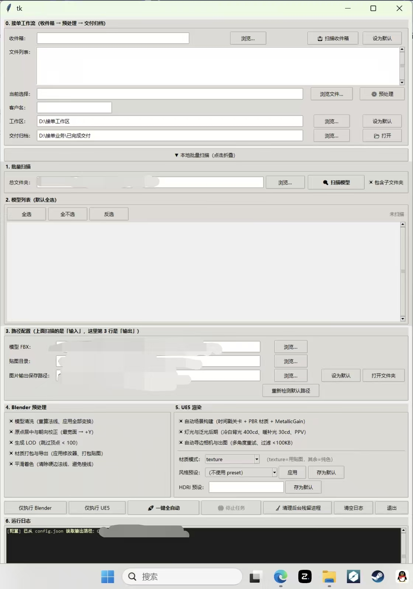
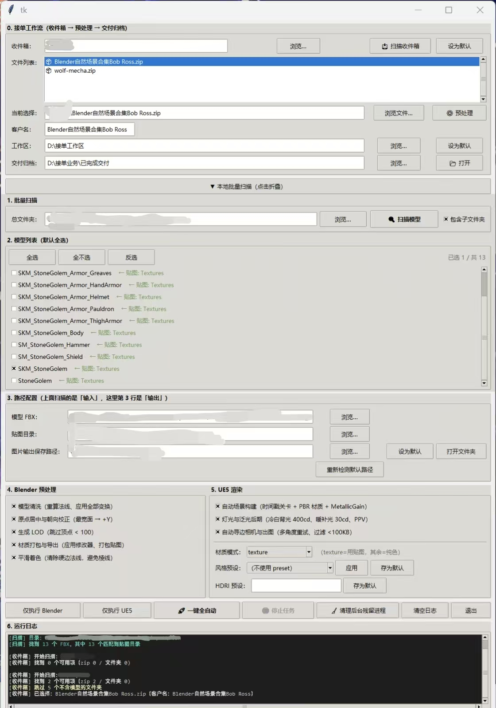
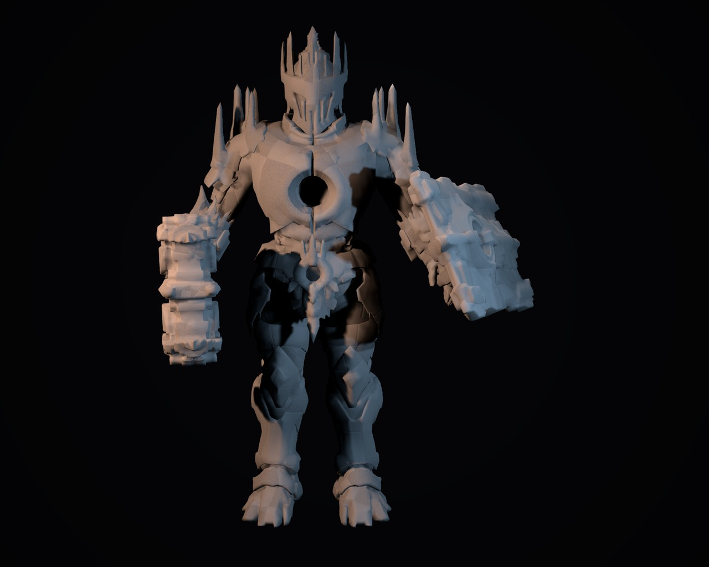
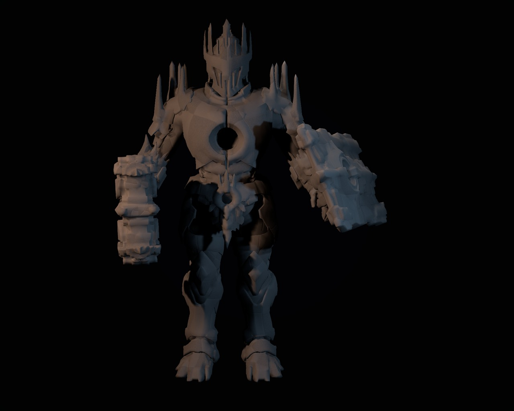
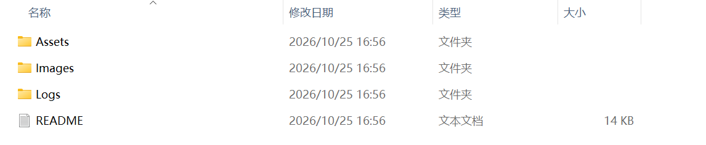

# Pipeline_Tool — UE5 全自动资产渲染流水线

> 一个把 **FBX 模型 → LOD 减面 → 材质生成 → 打光出图 → 交付归档** 串成一条命令的
> 桌面工具。基于 Unreal Engine 5 实时渲染 + Blender 无头批处理，全程不需要手动开
> 编辑器点来点去。

<!-- ==================== 主图（放 docs/images/ 下） ==================== -->


---

## 目录

- [项目简介](#项目简介)
- [核心功能](#核心功能)
- [快速开始](#快速开始)
- [目录结构](#目录结构)
- [配置说明](#配置说明)
- [常见问题](#常见问题)
- [许可](#许可)

---

## 项目简介

`Pipeline_Tool` 解决的是资产外包/代渲场景里最枯燥的那部分工作：

拿到一个 `.fbx`，通常要做这些事——导入引擎、检查单位与朝向、修材质、调光照、
摆相机、渲三个角度、导 LOD、把成品按客户名分好文件夹、写一份交付说明。
一个模型手工做完要 20～40 分钟，而且每次结果都不完全一样。

这个工具把整套流程做成了可复现的自动化流水线：

- **输入**：一个 zip 或者一个 fbx
- **输出**：按类型分好目录的 PNG 成品 + 真 LOD 减面模型 + 交付清单

关键技术点：

| 技术点 | 实现方式 |
| --- | --- |
| 引擎驱动 | UE5 Python API（`unreal` 模块），通过 `UnrealEditor.exe` 子进程执行 |
| 场景搭建 | 脚本化生成 Level、相机、灯光、渐变背景球 |
| 出图 | `SceneCapture2D` + `RenderTarget` → `export_render_target` |
| 减面 | Blender 无头模式（`blender -b -P`）+ Decimate 修改器 |
| 并发 | `threading` + `queue`，UI 与渲染子进程完全解耦 |
| 界面 | 标准库 `tkinter`（零第三方 GUI 依赖） |

---

## 核心功能

### 1. 一键自动导入

- 拖入 `.fbx` / `.zip` 即可，自动解压、自动识别贴图目录
- 自动修复 zip 中文乱码（`cp437 → gbk`）
- 自动清理文件名里的非法字符，避免 UE 导入失败
- 自动把中文工程路径转换成英文影子工程（规避 UE 的 CEF 崩溃问题）

### 2. 多材质模式

| 模式 | 说明 | 适用场景 |
| --- | --- | --- |
| `texture` | 使用模型自带贴图 | 有完整材质包的资产 |
| `plaster` | 纯白石膏（金属 0、粗糙 0.92） | 展示造型、客户看灰模 |
| `dark_metal` | 暗黑金属（金属 0.55、粗糙 0.55） | 高质感宣传图 |
| `rough_skin` | 粗糙皮肤质感 | 角色特写 |
| `emissive` | 自发光边缘 | 科幻/概念展示 |

### 3. 真实 LOD 减面

不是假的分辨率缩放，而是真正的多边形减面，实测数据如下
（测试模型 `StoneGolem`，LOD 比例 0.5 / 0.25 / 0.10）：

| 级别 | 顶点数 | 三角面数 | 相对 LOD0 |
| --- | --- | --- | --- |
| LOD0 | 23,791 | 45,704 | 100% |
| LOD1 | 12,213 | 22,846 | −50% |
| LOD2 | 6,286 | 11,417 | −75% |
| LOD3 | 2,636 | 4,563 | −90% |

### 4. 多角度批量出图

- 支持 90° / 135° / 180° / 225° / 270° 等多机位
- 每张图自动跟随相机重新布置灯光，避免背光死黑
- 球形渐变背景，无地平线接缝

### 5. 收件箱扫描

- 指定一个收件箱目录，自动发现新到的压缩包
- 预览待处理列表，勾选后批量入队
- 处理完成的自动归档，不会重复处理

### 6. 自动交付归档

- 按任务建立独立目录
- 自动生成 `README.txt` 交付说明（含模型信息、角度清单、文件列表）
- 保留原始 zip，成品单独归类

### 7. 断点与容错

- 渲染超时自动 kill 残留进程
- 单个任务失败不影响队列后续任务
- 全流程日志落盘，方便事后排查

---

<!-- ==================== 功能截图区 ==================== -->

## 界面预览

### 主界面



### 收件箱扫描



### 渲染成品

| 纯白石膏模式 | 暗黑金属模式 |
| --- | --- |
|  |  |

### 批量处理结果



---

## 快速开始

### 环境要求

| 项目 | 版本 | 必需 |
| --- | --- | --- |
| Python | 3.10+ | 是 |
| Unreal Engine | 5.3+（开发于 5.8） | 渲染需要 |
| Blender | 3.6+（开发于 5.2） | 减面需要 |
| 操作系统 | Windows 10 / 11 | 是 |

> GUI 本身可以在没有 UE / Blender 的机器上启动，只是无法实际出图。

### 安装

```bash
# 1. 克隆仓库
git clone https://github.com/<your-name>/Pipeline_Tool.git
cd Pipeline_Tool

# 2. 安装依赖（可选依赖缺了也能跑）
pip install -r requirements.txt
```

### 配置

复制示例配置，改成你本机的路径：

```bash
copy render_config_预设示例.jsonc render_config.json   # Windows
# cp render_config_预设示例.jsonc render_config.json   # macOS / Linux
```

需要改的关键字段：

```jsonc
{
  "project": {
    // UE 工程文件（.uproject）的完整路径
    "uproject": "D:/YourWorkspace/MyProject/MyProject.uproject",
    // Blender 可执行文件（也有默认自动探测）
    "blender_exe": "D:/YourWorkspace/Blender/blender.exe"
  },
  "output": {
    // 成品 PNG 输出目录
    "dir": "D:/YourWorkspace/output"
  },
  "inbox": {
    // 收件箱扫描目录（把待处理 zip 丢这里）
    "root": "D:/YourWorkspace/inbox"
  }
}
```

> `render_config.json` 已在 `.gitignore` 中忽略，不会被误提交。

### 运行

```bash
python Pipeline_Tool.py
```

界面出现后：

1. 点「浏览」选择 `.fbx` 或 `.zip`
2. 在「材质模式」下拉框里选 `plaster`（白模）或 `dark_metal`（质感图）
3. 勾选需要的角度
4. 点「开始渲染」
5. 成品出现在配置的输出目录，按任务名分子文件夹

### 打包成独立 exe（可选）

```bash
pip install pyinstaller
pyinstaller --noconfirm --onedir --windowed --name Pipeline_Tool Pipeline_Tool.py
```

> 必须用 `--onedir`。`--onefile` 在本项目上会因 VCRUNTIME 依赖释放失败而崩溃。

---

## 目录结构

```
Pipeline_Tool/
├── Pipeline_Tool.py              # 主程序：Tkinter GUI + 任务调度
├── ue_render_core.py             # 核心：UE 场景搭建 / 相机 / 灯光 / 背景
├── render_config.py              # 配置：默认值 + 读取 + 校验
├── render_config_预设示例.jsonc  # 配置模板（复制成 .json 后使用）
├── requirements.txt              # 依赖清单
├── .gitignore
├── README.md
└── docs/
    └── images/                   # README 引用的截图
        └── README.md             # 截图命名约定
```

---

## 配置说明

配置分三段优先级（后者覆盖前者）：

1. `render_config.py` 里的默认值
2. `render_config.json` 用户配置
3. GUI 上的运行时选项

主要段落：

| 段落 | 作用 |
| --- | --- |
| `project` | UE 工程、Blender 路径 |
| `output` | 输出目录、文件命名规则 |
| `quality` | 分辨率、抗锯齿、采样数 |
| `exposure` | EV 曝光补偿 |
| `lights` | 主光 / 补光 / 顶光强度 |
| `hdri` | 环境贴图目录与强度 |
| `camera` | 相机焦距、机位角度列表 |
| `background_wall` | 渐变背景球的上下颜色 |
| `model` | 材质模式、自定义 BaseColor |
| `inbox` | 收件箱扫描目录 |
| `archive` | 交付归档规则 |

---

## 常见问题

<details>
<summary><b>启动后点渲染没反应 / 出黑图</b></summary>

用 `UnrealEditor-Cmd.exe`（无头）跑本流程会出全黑帧，这是 UE 的已知行为。
必须用带窗口的 `UnrealEditor.exe`。脚本已默认这样做，请勿改成 Cmd 版本。
</details>

<details>
<summary><b>UE 启动报 CEF / webcache 错误</b></summary>

CEF 不支持中文路径。把 UE 工程放到纯英文路径下，或让工具自动生成英文影子工程
（`prepare_ascii_uproject()` 会自动处理）。
</details>

<details>
<summary><b>材质改了没生效</b></summary>

UE 对工程内 `/Game/` 下的资源有写锁。工具的做法是每次在带时间戳的新目录里创建
材质（如 `Materials_HHMMSS`），而不是复用旧资源。如果看到大量 `Materials_*` 目录，
那是正常产物，可以定期清理。
</details>

<details>
<summary><b>pip install 失败 / SSL 报错</b></summary>

常见于代理环境，重试一次通常就能过；或者临时用国内镜像：
```bash
pip install -r requirements.txt -i https://pypi.tuna.tsinghua.edu.cn/simple
```
</details>

<details>
<summary><b>为什么不用 PySide6？</b></summary>

GUI 用的是标准库 `tkinter`，装好 Python 就能跑，没有任何 GUI 第三方依赖。
换成 PySide6 会让发布包体积增加 200MB+，对这类工具不划算。
</details>

---

## 许可

MIT License

---

## 致谢

- Unreal Engine 5 Python API
- Blender Python API（`bpy`）
- 参考模型：StoneGolem
